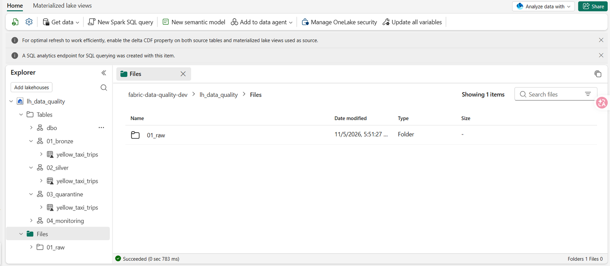
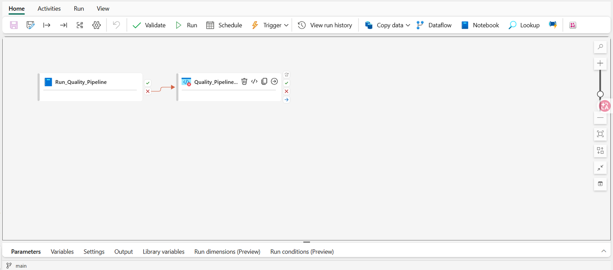
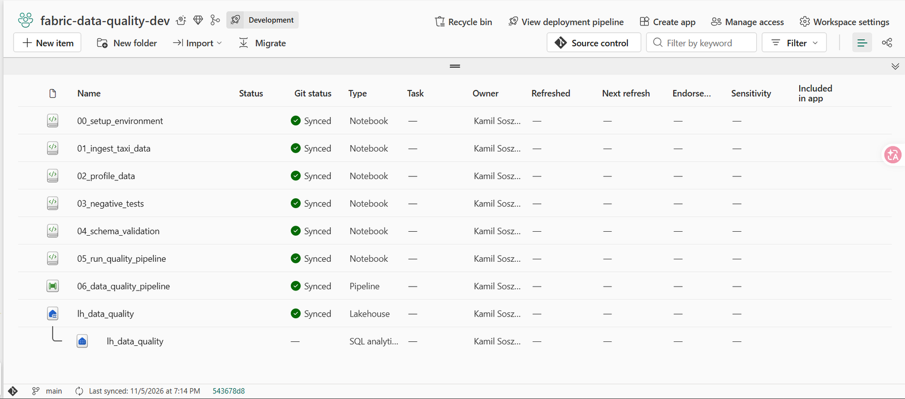

# Fabric Data Quality and Observability Platform

A production-oriented data quality and observability platform built with Microsoft Fabric, PySpark, Delta Lake, OneLake, Data Factory, GitHub integration, and Deployment Pipelines.

The project validates New York City Yellow Taxi trip records, separates valid and invalid records, records rule-level results, monitors ingestion freshness, reconciles data layers, and verifies the solution with automated negative tests.

## Project Status

**Version:** 1.0.0  
**Release status:** Production-ready portfolio release  
**Development environment:** Validated  
**Test environment:** Validated  
**Git integration:** Connected and synchronized  
**Deployment Pipeline:** Development to Test completed successfully  

## Business Scenario

Analytical platforms require more than successful data ingestion. Data must also be complete, structurally correct, internally consistent, traceable, and delivered within an expected service-level threshold.

This project implements a reusable quality control process for taxi trip data. Every record is evaluated against explicit rules and routed to one of two destinations:

- **Silver:** records that pass all mandatory quality rules
- **Quarantine:** records that fail one or more mandatory quality rules

Operational results are persisted in monitoring tables for auditing and troubleshooting.

## Source Dataset

The project uses one monthly file from the NYC Taxi and Limousine Commission Yellow Taxi Trip Records dataset.

| Property | Value |
|---|---|
| Dataset | NYC TLC Yellow Taxi Trip Records |
| Period | January 2026 |
| Source format | Parquet |
| Source file | `yellow_tripdata_2026-01.parquet` |
| Source records | 3,724,889 |
| Source columns | 20 |
| Technical columns added | 3 |
| Bronze columns | 23 |

Technical metadata added during ingestion:

- `_ingested_at`
- `_source_file`
- `_source_period`

The two trip datetime fields are explicitly stored as Spark `timestamp` values. This makes all 23 Bronze columns available through both Spark and the Fabric SQL analytics endpoint, where the datetime fields are exposed as `datetime2`.

## Architecture

```text
NYC TLC Parquet file
        |
        v
OneLake Files/01_raw
        |
        v
01_bronze.yellow_taxi_trips
        |
        v
PySpark quality validation
        |
        +-----------------------------+
        |                             |
        v                             v
02_silver.yellow_taxi_trips   03_quarantine.yellow_taxi_trips
        |                             |
        +--------------+--------------+
                       |
                       v
             04_monitoring tables
```

## Project Screenshots

### Lakehouse Quality Layers



### Data Quality Pipeline and Error Handling



### Development Workspace and Git Synchronization



## Lakehouse Organization

The Lakehouse uses ordinal schema prefixes to preserve the logical processing order in the Fabric explorer.

| Schema | Purpose |
|---|---|
| `01_bronze` | Immutable source-aligned data with ingestion metadata |
| `02_silver` | Records that passed all mandatory quality rules |
| `03_quarantine` | Rejected records with failed-rule details |
| `04_monitoring` | Quality, freshness, reconciliation, schema, test, and run history |
| `dbo` | Default Fabric schema |

## Data Quality Rules

The production validation process implements nine mandatory rules.

| Rule | Validation |
|---|---|
| `VENDOR_ID_NULL` | `VendorID` must not be null |
| `PICKUP_DATETIME_NULL` | Pickup timestamp must not be null |
| `DROPOFF_DATETIME_NULL` | Drop-off timestamp must not be null |
| `DROPOFF_BEFORE_PICKUP` | Drop-off timestamp must not precede pickup |
| `NEGATIVE_TRIP_DISTANCE` | Trip distance must not be negative |
| `PICKUP_LOCATION_NULL` | Pickup location must not be null |
| `DROPOFF_LOCATION_NULL` | Drop-off location must not be null |
| `FARE_AMOUNT_NULL` | Fare amount must not be null |
| `TOTAL_AMOUNT_NULL` | Total amount must not be null |

Each validated record receives:

- `_failed_rules`
- `_quality_status`
- `_quality_run_id`
- `_quality_checked_at`

## Profiling Results

Initial profiling identified five columns with the same missing-value pattern:

- `passenger_count`
- `RatecodeID`
- `store_and_fwd_flag`
- `congestion_surcharge`
- `Airport_fee`

Each column contains:

- **1,088,058 null values**
- **29.21% null rate**

The missing values occur together in the same records. These fields are treated as optional for the current business contract and do not automatically cause quarantine.

Negative monetary values are retained because profiling showed that they are concentrated in payment types associated with adjustments and reversals. They are not rejected solely on the basis of their sign.

## Validation Results

The production quality execution produced the following result in both Development and Test:

| Layer | Records |
|---|---:|
| Bronze | 3,724,889 |
| Silver | 3,724,888 |
| Quarantine | 1 |
| Reconciliation difference | 0 |

Detected production failure:

| Rule | Failed records |
|---|---:|
| `DROPOFF_BEFORE_PICKUP` | 1 |

Final pipeline status:

```text
Quality pipeline PASSED.
Bronze records: 3,724,889
Silver records: 3,724,888
Quarantine records: 1
Count difference: 0
```

## Schema Validation

The Bronze schema is validated against an explicit contract covering:

- column names,
- ordinal positions,
- data types,
- missing columns,
- unexpected columns.

The contract uses Spark `timestamp` for `tpep_pickup_datetime`, `tpep_dropoff_datetime`, and `_ingested_at`.

Results:

```text
Development: Schema validation PASSED: 23 of 23 columns.
Test:        Schema validation PASSED: 23 of 23 columns.
```

The Fabric SQL analytics endpoint also exposes all 23 columns, including both trip datetime fields as `datetime2`.

## Reconciliation

The reconciliation control verifies:

```text
Bronze count = Silver count + Quarantine count
```

Validated result:

```text
3,724,889 = 3,724,888 + 1
```

The recorded difference is `0`, and the reconciliation status is `PASSED` in both Development and Test.

## Freshness SLA

The project records the most recent ingestion timestamp and calculates data age in hours.

| Metric | Value |
|---|---|
| SLA threshold | 24 hours |
| Status | `PASSED` |

The current SLA measures ingestion freshness relative to the pipeline execution time. It does not measure the publication delay of the external source.

## Negative Tests

The project contains one synthetic invalid record for each production quality rule.

Automated assertions verify that every expected rule is detected. Notebook execution fails if any test returns `FAILED`.

Results:

```text
Development: All negative tests PASSED: 9 of 9.
Test:        All negative tests PASSED: 9 of 9.
```

## Monitoring Tables

The `04_monitoring` schema contains the following operational outputs:

| Table | Purpose |
|---|---|
| `quality_run_summary` | Passed and quarantined record counts |
| `quality_rule_results` | Current rule-level failure results |
| `freshness_sla_results` | Data age and SLA status |
| `negative_test_results` | Persisted automated negative-test results |
| `reconciliation_results` | Bronze, Silver, and Quarantine reconciliation |
| `schema_validation_results` | Column-level schema contract validation |
| `pipeline_run_history` | Historical production pipeline executions |
| `quality_rule_history` | Historical rule-level results by run |

Each production run receives a unique `run_id`.

## Fabric Items

| Item | Type | Purpose |
|---|---|---|
| `00_setup_environment` | Notebook | Creates the ordered Lakehouse schemas |
| `01_ingest_taxi_data` | Notebook | Downloads, validates, type-normalizes, and ingests the Parquet source |
| `02_profile_data` | Notebook | Profiles schema and missing values |
| `03_negative_tests` | Notebook | Runs and persists nine automated negative tests |
| `04_schema_validation` | Notebook | Validates and persists the 23-column schema contract |
| `05_run_quality_pipeline` | Notebook | Executes the production quality process |
| `06_data_quality_pipeline` | Data Pipeline | Orchestrates the production notebook |
| `lh_data_quality` | Lakehouse | Stores source files, Delta tables, and monitoring results |

## Pipeline Error Handling

The Fabric Data Pipeline contains:

- `Run_Quality_Pipeline`, which executes `05_run_quality_pipeline`
- `Quality_Pipeline_Failed`, which is connected through the `On failure` path

Configured failure details:

```text
Error code: DQ_PIPELINE_FAILED
Failure message: The data quality notebook execution failed.
```

Successful pipeline executions do not invoke the failure activity.

## Environments

The solution uses two Fabric workspaces:

| Stage | Workspace |
|---|---|
| Development | `fabric-data-quality-dev` |
| Test | `fabric-data-quality-test` |

The Deployment Pipeline is named:

```text
fabric-data-quality-deployment
```

The final implementation was deployed from Development to Test. Lakehouse definitions and supported Fabric items were deployed, while Lakehouse data and tables were recreated in Test through controlled notebook execution.

## Test Environment Verification

The following controls passed after the final timestamp-compatibility deployment:

- ordered Lakehouse schemas created successfully,
- Bronze ingestion completed successfully,
- 3,724,889 records and 23 columns loaded,
- both trip datetime columns persisted as Spark `timestamp`,
- all 23 columns exposed through the SQL analytics endpoint,
- schema validation passed 23 of 23 checks,
- production quality pipeline passed,
- reconciliation difference equals zero,
- all 9 negative tests passed.

## Git Integration

The Development workspace is connected to this GitHub repository.

| Property | Value |
|---|---|
| Provider | GitHub |
| Branch | `main` |
| Workspace | `fabric-data-quality-dev` |
| Synchronization | Workspace to Git |
| Pending Fabric changes after synchronization | 0 |

The GitHub fine-grained personal access token is restricted to this repository and uses:

- `Contents: Read and write`
- `Metadata: Read-only`

No token or secret is stored in the repository.

## Repository Structure

```text
.
├── 00_setup_environment.Notebook/
├── 01_ingest_taxi_data.Notebook/
├── 02_profile_data.Notebook/
├── 03_negative_tests.Notebook/
├── 04_schema_validation.Notebook/
├── 05_run_quality_pipeline.Notebook/
├── 06_data_quality_pipeline.DataPipeline/
├── docs/
│   └── images/
├── lh_data_quality.Lakehouse/
├── LICENSE
└── README.md
```

## Idempotency

The current implementation supports repeatable execution in the following ways:

- Bronze ingestion uses overwrite mode,
- Silver and Quarantine tables use overwrite mode,
- current monitoring snapshots use overwrite mode,
- monitoring history tables use append mode,
- each production run receives a unique `run_id`,
- reconciliation prevents silent record loss,
- schema validation stops execution when the contract changes,
- negative-test assertions stop execution when rule behavior changes.

## Known Limitations

- The source file is downloaded from an external HTTPS endpoint before Spark reads the Parquet file.
- The ingestion processes one monthly file.
- Bronze, Silver, and Quarantine processing is full-load rather than incremental.
- Optional-field nulls are profiled but do not currently cause quarantine.
- Negative monetary values are retained as potential adjustment or reversal transactions and are not classified by a dedicated business-rule dimension.
- The 24-hour freshness SLA measures ingestion recency, not source publication timeliness.
- Lakehouse data is not transferred by the Deployment Pipeline and must be loaded separately in each environment.
- Alerts and external incident notifications are not included in version 1.0.0.
- Secrets must remain outside notebooks, Git history, screenshots, and documentation.

## Potential Extensions

Future versions can add:

- parameterized monthly ingestion,
- incremental processing and watermarks,
- schema evolution policies,
- configurable rule metadata,
- severity levels,
- warning and rejection thresholds,
- duplicate detection,
- business-domain validation,
- explicit adjustment and reversal classification,
- historical SLA trend analysis,
- Microsoft Teams notifications,
- automated pipeline scheduling,
- CI validation and pull-request checks.

## Security

The repository must never contain:

- GitHub personal access tokens,
- passwords,
- connection secrets,
- private keys,
- credentials embedded in notebook code.

If a token is exposed, revoke it immediately in GitHub and create a replacement with the minimum required repository permissions.

## Technology Stack

- Microsoft Fabric
- Fabric Lakehouse
- OneLake
- Apache Spark
- PySpark
- Delta Lake
- Fabric Data Factory
- Fabric Deployment Pipelines
- GitHub
- NYC TLC Yellow Taxi Trip Records

## Skills Demonstrated

- **Data Engineering:** Building a medallion-style architecture with Bronze, Silver, and Quarantine layers using PySpark and Delta Lake in Microsoft Fabric.
- **Data Quality and Observability:** Implementing rule-based validation, schema contracts, reconciliation, freshness SLAs, persisted monitoring, and automated negative tests.
- **Data Orchestration:** Managing end-to-end workflows with Fabric Data Factory pipelines and explicit failure handling.
- **DevOps and CI/CD:** Using Fabric Deployment Pipelines for Development-to-Test promotion and GitHub integration for version control.

## Challenges and Lessons Learned

- **Cross-engine timestamp compatibility:** Source `timestamp_ntz` fields were explicitly normalized to Spark `timestamp`, ensuring that Spark retained the correct semantics while the Fabric SQL analytics endpoint exposed both fields as `datetime2`.
- **Schema contract enforcement:** A persisted 23-column validation contract detects name, order, type, missing-column, and unexpected-column changes before downstream use.
- **Reconciliation logic:** The equality `Bronze = Silver + Quarantine` prevents silent record loss across quality-routing operations.
- **Test-environment configuration:** Deployed notebooks require the Test Lakehouse to be attached as the default context before using partial table namespaces.
- **Operational verification:** A successful notebook message is not sufficient by itself. Persisted table schemas, monitoring records, pipeline history, Git synchronization, and Test deployment must also be verified.

## Release

Version `1.0.0` represents the first portfolio-ready release of the platform. The release includes:

- end-to-end Development and Test validation,
- SQL-compatible timestamp handling,
- 23-column schema-contract enforcement,
- nine production quality rules,
- nine automated negative tests,
- complete Bronze-to-Silver-and-Quarantine reconciliation,
- freshness monitoring and run history,
- GitHub synchronization and Fabric Deployment Pipeline verification.

## License

This project is licensed under the [MIT License](LICENSE).
